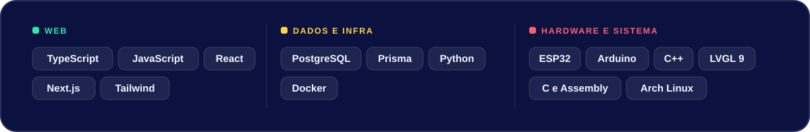

  
  &nbsp;
  

  Eu construo sistemas para quem trabalha longe do escritório: 
  o barbeiro no balcão, o técnico em cima da escada, o encarregado com a prancheta. 
  Escuto quem vai usar, mostro um protótipo navegável e publico com link próprio. 
  Quando o problema sai da tela, programo ESP32.

## Em destaque

**Workito** é um CRM SaaS multiempresa para equipes de vendas. Cada empresa tem seus dados isolados e cinco perfis de acesso.
O repositório é privado, mas posso mostrar ao vivo numa conversa.

`Next.js 16` `React 19` `TypeScript` `PostgreSQL` `Prisma` `Better Auth` `Docker`

## Sistemas para testar agora

<table>
  <tr>
    <td width="50%" valign="top">
      
      <h3>Navalha</h3>
      <b>Agenda de barbearia.</b> Agenda do dia e da semana, recepção e agendamento online.  
      <a href="https://lorranbrs.github.io/sistema-de-barbearia-demo/"><b>Abrir a demo →</b></a>
    </td>
    <td width="50%" valign="top">
      
      <h3>CRM Plus</h3>
      <b>CRM para escolas.</b> Leads, simulador de matrícula, financeiro e agenda.  
      <a href="https://lorranbrs.github.io/CRM-Plus/"><b>Abrir a demo →</b></a> · <a href="https://github.com/LorranBRS/CRM-Plus">código</a>
    </td>
  </tr>
  <tr>
    <td width="50%" valign="top">
      
      <h3>RelatorioTec</h3>
      <b>Relatório técnico.</b> Fotos, medições e assinatura na tela, saindo em PDF pelo WhatsApp.  
      <a href="https://lorranbrs.github.io/RelatorioTec/"><b>Abrir a demo →</b></a> · <a href="https://github.com/LorranBRS/RelatorioTec">código</a>
    </td>
    <td width="50%" valign="top">
      
      <h3>PMOC</h3>
      <b>Manutenção de ar-condicionado.</b> O técnico preenche a visita no celular e sai com o PDF do plano.  
      <a href="https://lorranbrs.github.io/PMOC/"><b>Abrir a demo →</b></a> · <a href="https://github.com/LorranBRS/PMOC">código</a>
    </td>
  </tr>
  <tr>
    <td width="50%" valign="top">
      
      <h3>Estoque de EPI</h3>
      <b>Controle de equipamentos.</b> Entradas, saídas por funcionário, alertas e planilhas.  
      <a href="https://lorranbrs.github.io/controle-estoque-epi/"><b>Abrir a demo →</b></a> · <a href="https://github.com/LorranBRS/controle-estoque-epi">código</a>
    </td>
    <td width="50%" valign="top">
      <h3>Também no portfólio</h3>
      <b>Albion em Alta.</b> Ranking e previsão de preços do mercado do Albion Online, em Python.  
      <b>LorranWatch.</b> Firmware de smartwatch para ESP32-S3 com tela AMOLED, em C++ e LVGL 9.  
      <a href="https://lorranbrs.github.io/site-portfolio/#projetos"><b>Ver todos no site →</b></a>
    </td>
  </tr>
</table>

## Com o que eu trabalho

 

