  
  

Eu construo sistemas para quem trabalha longe do escritório: o barbeiro no balcão, o técnico em cima da escada,
o encarregado com a prancheta. Escuto quem vai usar, mostro um protótipo navegável e publico com link próprio.
Quando o problema sai da tela, programo ESP32.

## Em destaque

**Workito** é um CRM SaaS multiempresa para equipes de vendas. Cada empresa tem seus dados isolados e cinco perfis de acesso.
5 de 7 fases prontas. Repositório privado, posso mostrar ao vivo numa conversa.

| Pronto no MVP | Em breve |
|---|---|
| Funil de vendas · Leads · Comunicação · Propostas · Atividades · Dashboard · Planilhas (CSV, Excel e PDF) | Análise de documentos · Análise de feedback |

`Next.js 16` `React 19` `TypeScript` `PostgreSQL` `Prisma` `Better Auth` `Docker`

## Sistemas para testar agora

<table>
  <tr>
    <td width="50%" valign="top">
      
      <h3>Navalha · agenda de barbearia</h3>
      Agenda do dia e da semana, recepção e agendamento online. 
      <a href="https://lorranbrs.github.io/sistema-de-barbearia-demo/"><b>Abrir a demo →</b></a>
    </td>
    <td width="50%" valign="top">
      
      <h3>CRM Plus · CRM para escolas</h3>
      Leads, simulador de matrícula, financeiro e agenda. 
      <a href="https://lorranbrs.github.io/CRM-Plus/"><b>Abrir a demo →</b></a> · <a href="https://github.com/LorranBRS/CRM-Plus">código</a>
    </td>
  </tr>
  <tr>
    <td width="50%" valign="top">
      
      <h3>RelatorioTec · relatório técnico</h3>
      Fotos, medições e assinatura na tela, saindo em PDF pelo WhatsApp. 
      <a href="https://lorranbrs.github.io/RelatorioTec/"><b>Abrir a demo →</b></a> · <a href="https://github.com/LorranBRS/RelatorioTec">código</a>
    </td>
    <td width="50%" valign="top">
      
      <h3>PMOC · manutenção de ar-condicionado</h3>
      O técnico preenche a visita no celular e sai com o PDF do plano. 
      <a href="https://lorranbrs.github.io/PMOC/"><b>Abrir a demo →</b></a> · <a href="https://github.com/LorranBRS/PMOC">código</a>
    </td>
  </tr>
  <tr>
    <td width="50%" valign="top">
      
      <h3>Estoque de EPI</h3>
      Entradas, saídas por funcionário, alertas e planilhas. 
      <a href="https://lorranbrs.github.io/controle-estoque-epi/"><b>Abrir a demo →</b></a> · <a href="https://github.com/LorranBRS/controle-estoque-epi">código</a>
    </td>
    <td width="50%" valign="top">
      <h3>Também no portfólio</h3>
      <b>Albion em Alta</b>: ranking e previsão de preços do mercado do Albion Online, em Python.  
      <b>LorranWatch</b>: firmware de smartwatch para ESP32-S3 com tela AMOLED, em C++ e LVGL 9.  
      <a href="https://lorranbrs.github.io/site-portfolio/#projetos"><b>Ver todos no site →</b></a>
    </td>
  </tr>
</table>

## Com o que eu trabalho

  
  
  
  
  
  
  
  
  
  
  
  

---

<b>Seu processo ainda vive no papel?</b> Me chama pelo <a href="https://lorranbrs.github.io/site-portfolio/#contato">portfólio</a>.

